

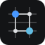

# Lattice UI

**Operational interfaces, without the visual debt.**

A dense, calm design system for dashboards, device management, settings and telemetry, with a live incident simulator.

[Live demo](https://anilams.github.io/lattice-ui/) · [Components](docs/components.md) · [Registry](docs/registry.md) · [Design rules](DESIGN.md) · [Changelog](CHANGELOG.md) · [中文](README.zh-CN.md)

v0.2.0 preview · live incident simulation · public demo + preview registry

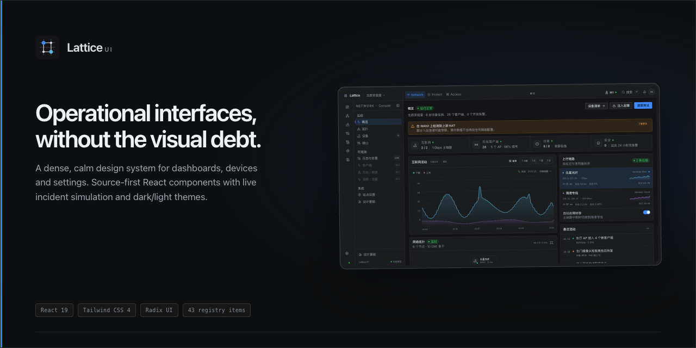

## Why Lattice UI

Operational software has a different job from a marketing page. It has to be scanned, compared and trusted at 2 a.m. Lattice UI is built around that job: compact type, stable tables, quiet surfaces and a single action color. The repository ships the system and a working console so every rule can be tested in context.

| | What makes it useful |
|---|---|
| **Console-first density** | A 30 px control height, 38 px rows and tabular numerals are the default, with a roomy mode for forms and reading. |
| **Source you can own** | Components are copied into your project through a shadcn-style registry. Edit the source, keep the tokens, keep the behavior. |
| **Two themes, two densities** | Dark and light are full semantic swaps. Compact and roomy change component dimensions without changing the type scale. |
| **Domain blocks, not just buttons** | TopologyWorkbench, PortMatrix, LogStream, FilterPanel, DataTable, DetailPanel, TrafficPanel, SettingsSection and AppShell solve the screens this category repeats. |
| **Accessibility as behavior** | Radix primitives, visible focus, focus restoration, Escape ordering, reduced motion, keyboard-inspectable charts and explicit empty states. |
| **No charting dependency** | The traffic chart and topology map are dependency-free SVG/HTML, so the visual system stays inspectable and portable. |

## What's inside

The repository contains 43 registry items and seven reference pages.

| Layer | Included |
|---|---|
| Foundations | Theme tokens, light/dark modes, compact/roomy density, utilities and console types |
| Primitives | Button, IconButton, Badge, StatusDot, Panel, Input, Checkbox, Switch, Tabs, Tooltip, DropdownMenu, Select, Dialog, Sheet, Separator, Skeleton, InlineNotice, Toast |
| Console blocks | Brand, Page primitives, HealthStrip, DeviceGlyph, DeviceStatusBadge, Sparkline, TrafficChart, TrafficPanel, TopologyMap, TopologyWorkbench, FilterPanel, EmptyState, DataTable, SettingsSection, ActivityFeed, DetailPanel, LiveValue, PortMatrix, LogStream, AppShell |
| Reference app | Overview, Topology, Devices, Ports, Logs & Alerts, Settings and Design Foundations |

## Preview

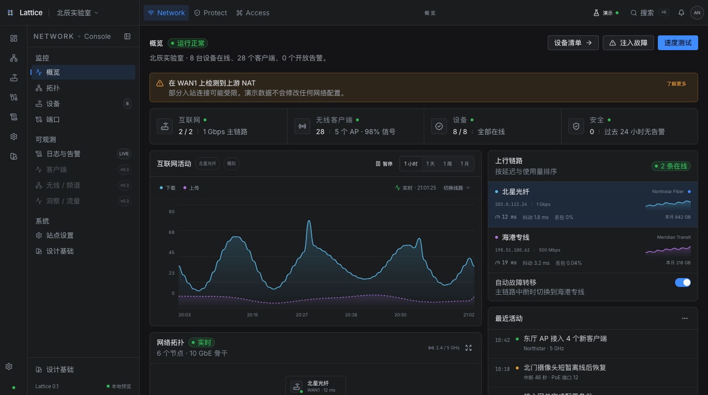

| Device list | Detail panel |
|---|---|
| 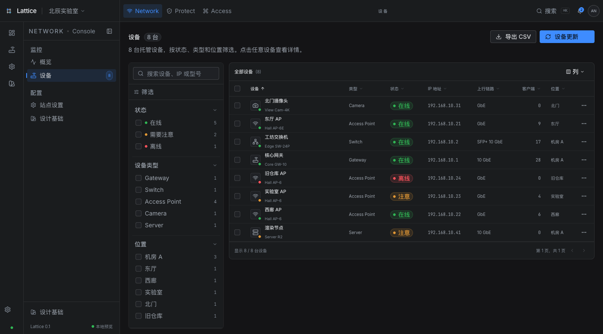 | 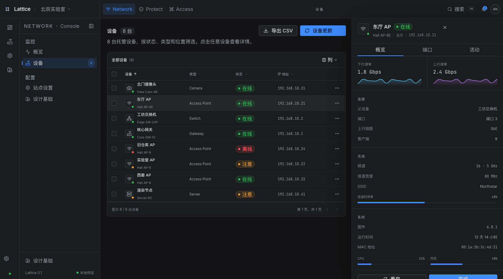 |

| Light theme | Narrow layout |
|---|---|
| 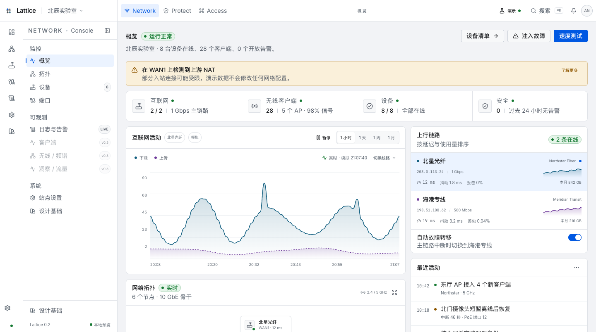 | 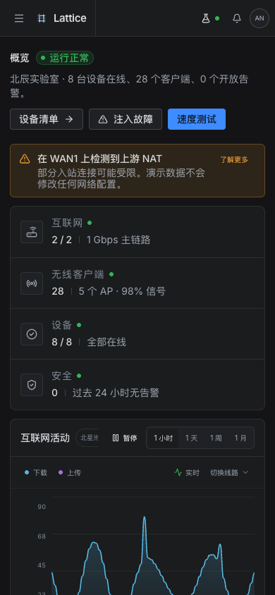 |

| Topology incident | Port matrix | Live logs and alerts |
|---|---|---|
| 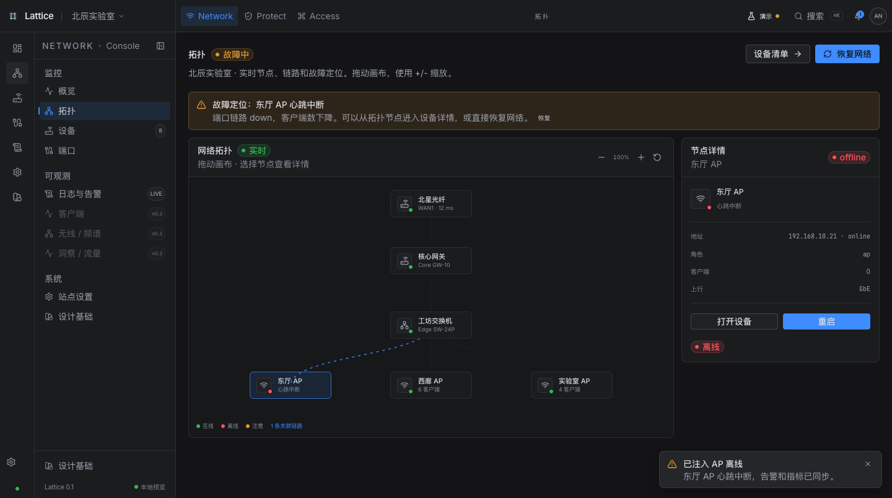 | 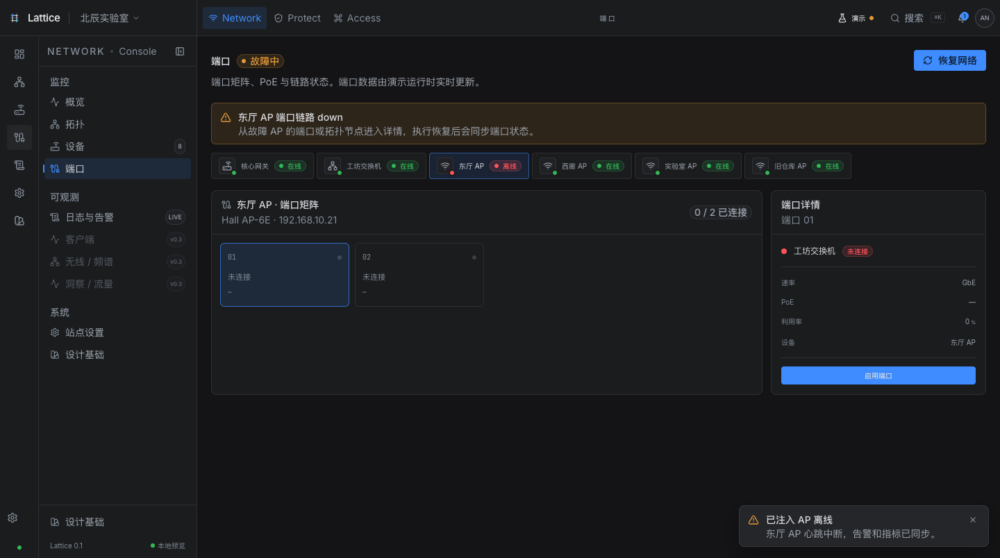 | 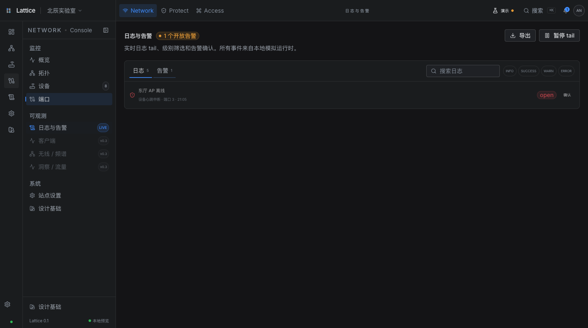 |

The secondary navigation becomes a drawer below 1024 px; below 768 px the top-bar menu replaces the rail. The device table scrolls horizontally, and the detail panel is non-modal at 1280 px and above and becomes a modal sheet below that breakpoint.

## Live incident demo

Open **Demo** in the top bar to pause sampling, change the simulation speed, inject an AP failure or WAN degradation, recover, or reset. The same incident propagates through the overview, topology, device table, port matrix and log stream. The chart interpolates data continuously instead of remounting, and live numbers tween with reduced-motion support.

## Quick start

Tested with Node.js 24 and pnpm 11.25.0. The package declares Node.js >=20.19.0 and pnpm >=10; Vite 8 requires Node.js 20.19+ or 22.12+.

~~~bash
git clone https://github.com/Anilams/lattice-ui.git
cd lattice-ui
pnpm install
pnpm dev
~~~

Open http://127.0.0.1:4173/. If pnpm reports that esbuild build scripts were ignored, run <code>pnpm approve-builds</code> once.

## Install into an existing app

The preview registry is live with the demo on GitHub Pages. It currently uses the mutable <code>/r</code> channel; pinned version directories are a release follow-up. The upstream shadcn CLI and the repository's local installer both resolve the source dependency closure.

Requirements for the CLI path: a React 19 + Tailwind CSS 4 project, a configured <code>@/*</code> alias, and a shadcn-initialized project with a global stylesheet.

~~~bash
# Install a primitive
npx shadcn@latest add https://anilams.github.io/lattice-ui/r/button.json
npx shadcn@latest add https://anilams.github.io/lattice-ui/r/badge.json

# Install the table and its dependencies
npx shadcn@latest add https://anilams.github.io/lattice-ui/r/data-table.json

# Install the console shell
npx shadcn@latest add https://anilams.github.io/lattice-ui/r/app-shell.json
~~~

Add the theme to the consumer's global stylesheet:

~~~css
@import "tailwindcss";
@import "./styles/lattice/lattice.css";
~~~

For an offline or forked registry, copy the source closure and then install the npm packages the installer prints:

~~~bash
pnpm registry
node scripts/install.mjs data-table detail-panel --target ../my-app
~~~

The local installer writes under <code>src</code> by default. Use <code>--src .</code> for a root-level source tree. It copies source files and prints the npm dependency command; it does not run the package manager. Conflicts abort before any file is written; a missing dependency exits non-zero. See [docs/registry.md](docs/registry.md) for flags and consumer setup.

Forks should set <code>LATTICE_REGISTRY_URL</code> to their own Pages registry, regenerate, and replace the upstream repository URL in the install examples. The upstream-only drift check is skipped on forks.

## 30-second example

~~~tsx
import { Badge } from '@/components/ui/badge'
import { DataTable, type DataTableColumn } from '@/components/console/data-table'

type Device = { id: string; name: string; status: 'online' | 'attention' }

const rows: Device[] = [
  { id: 'gw', name: 'Core Gateway', status: 'online' },
  { id: 'ap', name: 'Hall AP', status: 'attention' },
]

const columns: DataTableColumn<Device>[] = [
  { id: 'name', header: 'Device', sortValue: (row) => row.name, cell: (row) => row.name },
  {
    id: 'status',
    header: 'Status',
    cell: (row) => <Badge tone={row.status === 'online' ? 'success' : 'warning'}>{row.status}</Badge>,
  },
]

export function Devices() {
  return <DataTable rows={rows} columns={columns} getRowId={(row) => row.id} />
}
~~~

When <code>onRowClick</code> is provided, include a named button in a cell or an equivalent keyboard action. Semantic rows stay semantic.

## Design rules

The visual language is deliberately narrow. A few rules carry most of it:

- **Information earns the space.** Decoration never competes with a reading or comparison task.
- **Weak hierarchy, strong alignment.** Canvas, shell, surface and raised surface differ by a few lightness steps; borders are one pixel.
- **Action color is a budget.** Blue marks primary actions, current navigation, selection and focus. Chart series use cyan and violet; status uses green, amber and red.
- **Keep context visible.** On wide screens, detail opens beside the list. Below 1280 px it becomes a modal drawer.
- **States are redundant.** Text, icon or shape carries the meaning alongside color.
- **Motion reports state.** Hover and focus settle in 120 ms; dialogs in 180 ms; panels in 240 ms. Reduced motion removes translation, scaling and chart wipes.

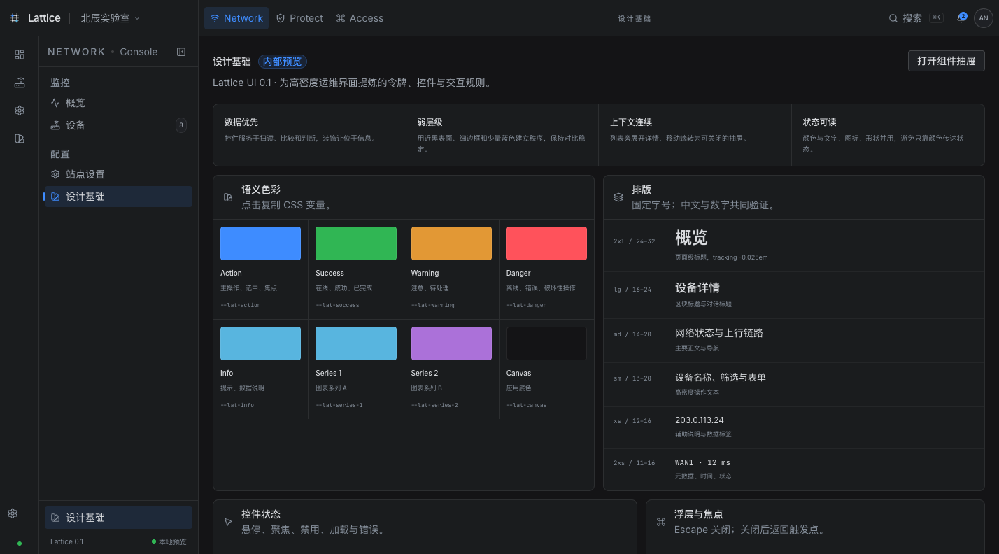

## Themes and density

~~~tsx
document.documentElement.classList.toggle('dark', theme === 'dark')
document.documentElement.classList.toggle('light', theme === 'light')
document.documentElement.dataset.density = density // compact | roomy
~~~

The runtime token source is [src/styles/tokens.css](src/styles/tokens.css). The generated [tokens.json](tokens.json) is a machine-readable export for tooling. Components consume semantic tokens rather than raw palette values.

## Accessibility

The reference app targets WCAG 2.2 AA and includes keyboard navigation, visible focus, focus restoration for overlays, nested Escape ordering, accessible sorting, chart keyboard inspection and reduced-motion handling. Empty data is a supported state.

The following verification is still outstanding before a production release:

- screen-reader passes with VoiceOver, NVDA and JAWS;
- 320 px reflow and 200% text zoom;
- a complete contrast matrix for component boundaries and muted-on-soft combinations;
- a full automated and manual WCAG audit.

Automated checks are useful evidence, not certification. The tested compatibility boundary is React 19 + Tailwind CSS 4 in a Vite consumer; React 18, Tailwind 3, Next.js SSR/RSC and other browsers are unverified.

## Registry

Every item is generated from the same source the app uses. No duplicate component tree.

| Category | Items |
|---|---|
| Theme and libs | theme, utils, types, control, motion |
| UI | 18 primitives listed above |
| Blocks | 20 console compositions listed above |

The registry was tested with shadcn 4.21.5 for <code>button</code>, <code>data-table</code>, <code>app-shell</code> and <code>detail-panel</code>, and with a local installer for the full closure. The public Pages URLs are checked anonymously. Toolchain: Node 24 and pnpm 11.25.0. This is a preview channel; pin a version directory before promising reproducible installs. See [docs/registry.md](docs/registry.md) for the item schema, compatibility notes and release checklist.

## Project structure

~~~text
src/
  components/ui/         Primitive controls
  components/console/    Console blocks and shared types
  styles/tokens.css      Runtime token source
  styles/lattice.css     Tailwind mapping, base styles and motion
  data/demo.ts           Fictional demo data
  pages/                 Seven reference pages
scripts/
  build-registry.mjs     Generates public/r/*.json
  install.mjs            Installs items into a consumer
  export-tokens.mjs      Writes tokens.json
public/r/                Published registry
docs/                    Component, registry and evidence docs
~~~

## Use as a Codex skill

The repository includes [SKILL.md](SKILL.md) for agent workflows. Copy the folder into your Codex skills directory, or point an agent at <code>SKILL.md</code> and <code>DESIGN.md</code> when building a console surface.

## Roadmap

- [x] Token system, dark/light themes and two densities
- [x] 43 source registry items and a working local installer
- [x] shadcn CLI install path and consumer build verification
- [x] Seven-page reference console with a live incident simulation and mobile behavior
- [ ] Full WCAG and screen-reader audit
- [ ] JSON-first token generation and Figma export
- [ ] Marketing-site recipe
- [ ] Topology editing, port matrices and historical replay

## Contributing

Read [CONTRIBUTING.md](CONTRIBUTING.md) before opening a PR. Small, focused changes with screenshots and a state matrix are easiest to review. Please follow the [Code of Conduct](CODE_OF_CONDUCT.md).

~~~bash
pnpm typecheck
pnpm build
pnpm build:lib
pnpm registry
~~~

## License

[MIT](LICENSE) © 2026 Lattice UI contributors.

## Acknowledgements

The visual direction began as an independent study of UniFi's console and marketing site. Lattice UI is **not affiliated with or endorsed by Ubiquiti**. It contains no UniFi source code, logos, proprietary fonts, private screenshots or business data.

Built with [React](https://react.dev/), [Tailwind CSS](https://tailwindcss.com/), [Radix UI](https://www.radix-ui.com/), [Lucide](https://lucide.dev/), [Inter](https://rsms.me/inter/) and [JetBrains Mono](https://www.jetbrains.com/lp/mono/).

If this saves you a week of interface decisions, a star helps other teams find it.
